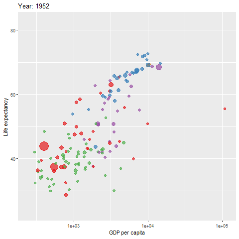
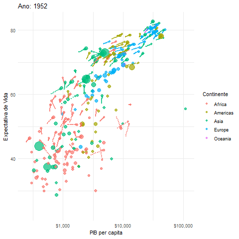

```{r setup, include=FALSE}
knitr::opts_chunk$set(echo = TRUE, warning = FALSE, message = FALSE, error = TRUE)
```

## Introdução

Gráficos estáticos são poderosos, mas às vezes a melhor maneira de mostrar uma história nos dados é através da animação, especialmente quando temos uma dimensão de tempo. Animações podem revelar tendências, mudanças e padrões que são difíceis de ver em um único gráfico.

Nesta aula, aprenderemos a criar gráficos animados em R usando o pacote `gganimate`, que funciona como uma extensão do `ggplot2` que já conhecemos.

**Nosso objetivo:** Transformar um gráfico `ggplot` estático em uma animação dinâmica.

------------------------------------------------------------------------

## Pré-requisitos e Conceito Principal

Para criar animações, precisaremos de três pacotes principais:

-   **`ggplot2`**: A base para a nossa visualização.
-   **`gganimate`**: A extensão que adiciona a camada de animação.
-   **`gifski`**: Um pacote que o `gganimate` usa nos bastidores para renderizar a animação em um arquivo GIF.

O conceito principal do `gganimate` é simples:

1.  Primeiro, você cria um gráfico `ggplot` estático completo.
2.  Depois, você adiciona uma ou mais funções do `gganimate` (começando com `transition_*()`) para dizer ao R *como* animar o gráfico.

```{r prerequisitos_animacao, message=FALSE}
# Certifique-se de que os pacotes estão instalados. Se não, rode no Console:
# install.packages(c("gganimate", "gifski", "gapminder"))

library(tidyverse) # Carrega ggplot2
library(gganimate)
library(gifski)
library(gapminder) # Usaremos este dataset para nosso exemplo
```

------------------------------------------------------------------------

## O Dataset `gapminder`

O dataset `gapminder` é perfeito para animações. Ele contém dados sobre a expectativa de vida, PIB per capita e população para muitos países, ao longo de vários anos (de 1952 a 2007).

```{r inspecionar_gapminder}
glimpse(gapminder)
```

Nossa meta é criar um gráfico de dispersão animado mostrando a relação entre `gdpPercap` (PIB per capita) e `lifeExp` (expectativa de vida) e como essa relação mudou ao longo do tempo (`year`).

------------------------------------------------------------------------

## Passo 1: Criar o Gráfico Estático

O primeiro passo é sempre criar o gráfico estático com todos os dados. A variável year em nosso dataset será a chave para a nossa animação, e a usaremos na próxima etapa para definir a transição ao longo do tempo.

```{r criar_plot_estatico}
# Criamos o objeto ggplot base
plot_estatico <- ggplot(
  gapminder, 
  aes(x = gdpPercap, y = lifeExp, size = pop, colour = continent)
) +
  geom_point(alpha = 0.7, show.legend = TRUE) + # Tornamos os pontos semi-transparentes
  scale_size(range = c(2, 12), guide = "none") + # Ajustamos o tamanho dos pontos
  scale_x_log10(labels = scales::dollar) + # Usamos escala de log para o PIB
  labs(
    x = 'PIB per capita', 
    y = 'Expectativa de Vida',
    color = 'Continente'
  ) +
  theme_minimal()

# Visualizar o gráfico estático (mostra todos os anos de uma vez)
plot_estatico
```

------------------------------------------------------------------------

## Passo 2: Adicionar a Camada de Animação

Agora vem a mágica do `gganimate`. Adicionamos uma camada `transition_*()` ao nosso gráfico estático para dizer como ele deve mudar. A mais comum é `transition_time()`.

```{r adicionar_camada_animacao}
plot_animado <- plot_estatico +
  transition_time(year) # Animar ao longo da variável 'year'
```

Ao fazer isso, o `gganimate` cria uma "tween" ou interpolação dos dados entre cada ano, criando quadros (frames) para uma animação suave.

------------------------------------------------------------------------

## Passo 3: Adicionar Rótulos Dinâmicos

Uma animação é muito mais informativa se pudermos ver qual "frame" de tempo está sendo exibido. `gganimate` nos dá acesso a "variáveis de frame" que podemos usar dentro de `labs()`. A mais útil é `{frame_time}`.

Vamos adicionar um título dinâmico ao nosso `plot_animado`.

```{r adicionar_rotulos_dinamicos}
plot_final_com_titulo <- plot_animado +
  labs(title = 'Ano: {frame_time}') # {frame_time} será substituído pelo valor de 'year' em cada frame
```

------------------------------------------------------------------------

## Passo 4: Renderizar e Salvar a Animação

O passo final é renderizar a animação. Usamos a função `animate()`.

**Atenção:** A renderização pode levar de alguns segundos a alguns minutos, dependendo da complexidade do gráfico e do número de frames.

```{r renderizar_animacao, eval=TRUE}
# O comando animate() irá gerar e exibir a animação no painel de Plots do RStudio.
# Para evitar renderizações longas durante a apresentação, o resultado é pré-gerado.
# Para rodar de verdade, troque 'eval=FALSE' por 'eval=TRUE' no chunk.

# animate(plot_final_com_titulo, renderer = gifski_renderer()) # Código para renderizar
```



**Para salvar sua animação em um arquivo:**

Use `anim_save()`. Ele salva a última animação que foi renderizada.

```{r salvar_animacao, eval=FALSE}
# Salva a animação como um arquivo .gif no seu diretório de trabalho
anim_save("gapminder_animacao.gif")
```

------------------------------------------------------------------------

## Polimento Adicional (Opcional)

`gganimate` oferece muitas outras funções para polir suas animações.

-   `view_follow()`: Mantém a janela de visualização focada nos dados enquanto eles se movem.
-   `shadow_wake()` ou `shadow_trail()`: Deixa um "rastro" dos pontos de dados de frames anteriores, útil para mostrar a trajetória ao longo do tempo.

Vamos adicionar um rastro à nossa animação:

```{r animacao_com_rastro, eval=FALSE}
# Adicionando um rastro com shadow_wake()
plot_com_rastro <- plot_estatico +
  transition_time(year) +
  labs(title = 'Ano: {frame_time}') +
  shadow_wake(wake_length = 0.1, alpha = FALSE) # Deixa um rastro dos pontos

# Renderizar esta nova versão
# animate(plot_com_rastro)
```



------------------------------------------------------------------------

## Conclusão

O fluxo de trabalho para criar animações com `gganimate` é uma extensão natural do `ggplot2`:

1.  **Crie o Gráfico Estático:** Construa seu gráfico `ggplot` completo, mapeando todas as estéticas necessárias (incluindo a variável de tempo).
2.  **Adicione a Transição:** Use uma função `transition_*()` (como `transition_time(variavel_de_tempo)`) para definir como a animação deve progredir.
3.  **Adicione Rótulos Dinâmicos:** Use `{frame_time}` ou outras variáveis de frame em `labs()` para dar contexto à animação.
4.  **Renderize e Salve:** Use `animate()` para visualizar e `anim_save()` para salvar seu trabalho como um arquivo GIF ou vídeo.

Com estes passos, você pode transformar visualizações estáticas em histórias dinâmicas e impactantes.
