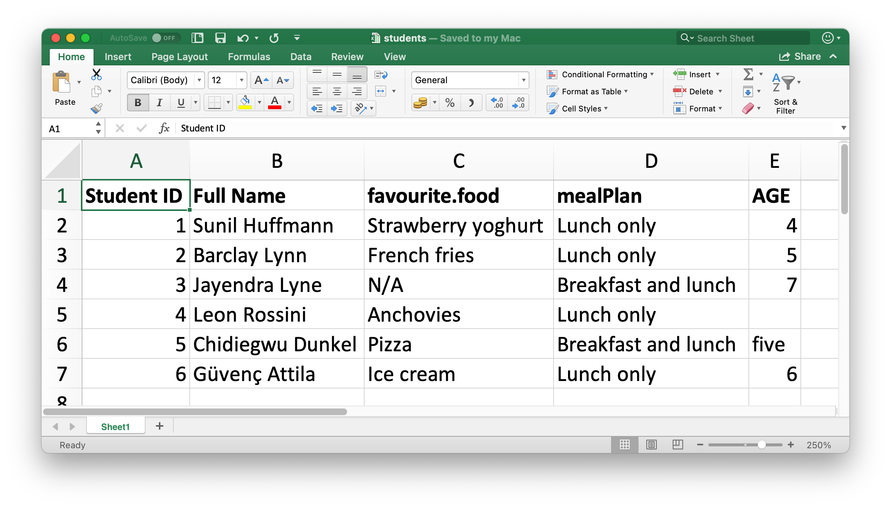
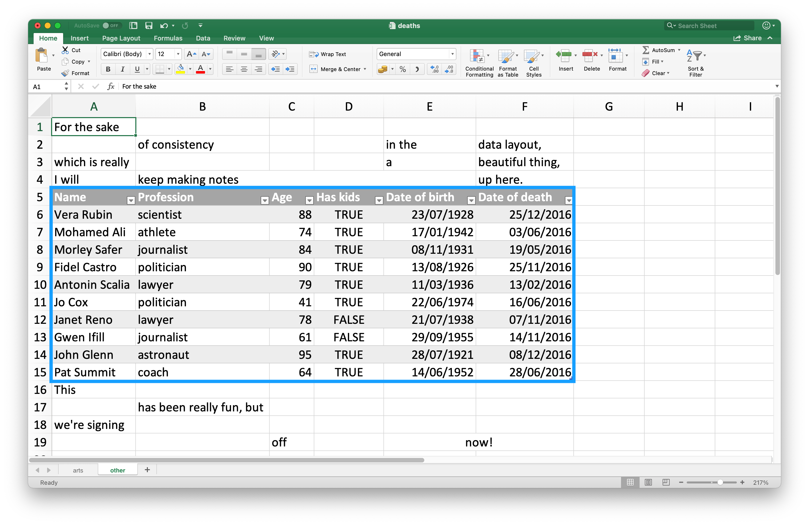
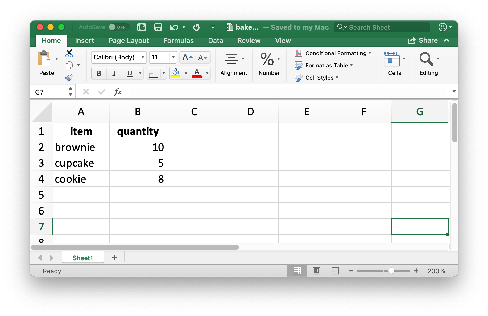
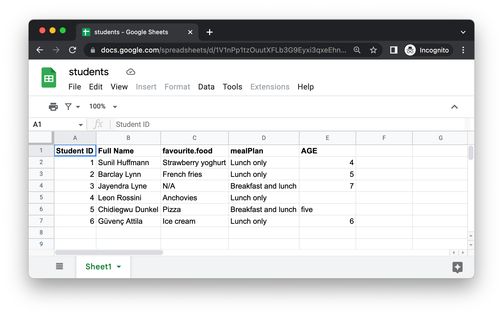

```{r setup, include=FALSE}
knitr::opts_chunk$set(echo = TRUE, warning = TRUE, message = TRUE)
# Criar diretórios se não existirem (para que o write_xlsx não falhe ao renderizar)
if (!dir.exists("dados")) {
  dir.create("dados", recursive = TRUE)
}
```

## 20.1 Introdução

No Capítulo 7, aprendemos sobre a importação de dados de arquivos de texto como `.csv` e `.tsv`. Agora, vamos aprender a extrair dados de planilhas, tanto do Excel quanto do Planilhas Google (Google Sheets).

Utilizaremos muito do que foi aprendido no Capítulo 7, mas também discutiremos considerações adicionais e complexidades presentes ao trabalhar com dados de planilhas.

**Leitura Recomendada:**
Se você ou seus colaboradores usam planilhas para organizar dados, é altamente recomendável a leitura do artigo "Organização de Dados em Planilhas" (Data Organization in Spreadsheets) de Karl Broman e Kara Woo: [https://doi.org/10.1080/00031305.2017.1375989](https://doi.org/10.1080/00031305.2017.1375989). As boas práticas apresentadas ajudarão a evitar dores de cabeça ao importar dados.

---

## 20.2 Excel

O Microsoft Excel é um software amplamente utilizado onde os dados são organizados em planilhas (worksheets) dentro de arquivos Excel (spreadsheets).

### 20.2.1 Pré-requisitos

Nesta seção, aprenderemos a carregar dados de arquivos do Excel para o R com o pacote `readxl`. Este pacote faz parte dos componentes secundários (non-core) do `tidyverse`, então devemos carregá-lo explicitamente. Usaremos também o pacote `writexl` para criar planilhas do Excel.

```{r prerequisitos_excel}
# install.packages("readxl") # Rode se não tiver instalado
# install.packages("writexl") # Rode se não tiver instalado
library(readxl)
library(tidyverse)
library(writexl)
```

---

### 20.2.2 Iniciando

O pacote `readxl` oferece várias funções para importar arquivos do Excel:

* `read_xls()`: Importa arquivos Excel no formato `.xls` (mais antigo).
* `read_xlsx()`: Importa arquivos Excel no formato `.xlsx` (mais recente).
* `read_excel()`: Pode importar arquivos em ambos os formatos (`.xls` e `.xlsx`), identificando o formato pelo tipo de arquivo.

Focaremos na função `read_excel()`.

---

### 20.2.3 Importando arquivos do Excel

Vamos importar uma planilha chamada `estudantes.xlsx`.
(Assumindo que o arquivo está em `dados/estudantes.xlsx`)

**Figura 20.1: Planilha do Excel chamada estudantes.xlsx.**



## Importando Estudantes

```{r importando_estudantes}
# O primeiro argumento é o caminho do arquivo.
# Crie a pasta "dados" e coloque o arquivo "estudantes.xlsx" nela.
# O arquivo pode ser baixado de: [https://github.com/cienciadedatos/pt-r4ds/raw/traducao-pt-2ed/data/estudantes.xlsx](https://github.com/cienciadedatos/pt-r4ds/raw/traducao-pt-2ed/data/estudantes.xlsx)
print(getwd())
estudantes_path <- "dados/estudantes.xlsx"

# Verifique se o arquivo existe antes de tentar ler
if (file.exists(estudantes_path)) {
  estudantes <- read_excel(estudantes_path)
  print(estudantes)
} else {
  cat("Arquivo '", estudantes_path, "' não encontrado. Por favor, baixe-o e coloque na pasta correta.\n", sep="")
}
```

---

#### Problemas Comuns e Soluções

Observando o `tibble` importado:

1.  **Nomes das colunas inconsistentes:** Use `col_names` para fornecer nomes consistentes (recomendamos *snake_case*).
    ```{r nomes_colunas, eval=file.exists(estudantes_path)}
    # Fornecendo nomes para as colunas
    novos_nomes <- c("estudante_id", "nome_completo", "comida_favorita", "refeicao_plano", "idade")
    estudantes_nomes_corrigidos <- read_excel(
      estudantes_path,
      col_names = novos_nomes
    )
    print(estudantes_nomes_corrigidos)
    ```
    O cabeçalho original agora é a primeira linha de dados.

---

#### Problemas Comuns e Soluções (cont.)

2.  **Cabeçalho como primeira linha:** Use `skip = 1` para pular a linha de cabeçalho original.
    ```{r skip_linha, eval=file.exists(estudantes_path)}
    estudantes_sem_cabecalho_original <- read_excel(
      estudantes_path,
      col_names = novos_nomes,
      skip = 1
    )
    print(estudantes_sem_cabecalho_original)
    ```

---

#### Problemas Comuns e Soluções (cont.)

3.  **Valores Ausentes Não Padrão:** A string "N/A" na coluna `comida_favorita` não é reconhecida como `NA` pelo R. Use o argumento `na` para especificar quais strings devem ser tratadas como `NA`.
    ```{r tratando_na, eval=file.exists(estudantes_path)}
    estudantes_com_na_corrigido <- read_excel(
      estudantes_path,
      col_names = novos_nomes,
      skip = 1,
      na = c("", "N/A") # Células vazias e "N/A" serão NA
    )
    print(estudantes_com_na_corrigido)
    ```

---

#### Problemas Comuns e Soluções (cont.)

4.  **Tipos de Coluna Incorretos:** A coluna `idade` é importada como texto (`<chr>`) devido ao valor "cinco". Para `read_excel`, os tipos de coluna são especificados com strings: `"skip"`, `"guess"`, `"logical"`, `"numeric"`, `"date"`, `"text"` ou `"list"`.
    ```{r especificando_col_types, eval=file.exists(estudantes_path), warning=TRUE}
    # Tentando forçar 'idade' para numérico diretamente
    estudantes_com_tipos_tentativa <- read_excel(
      estudantes_path,
      col_names = novos_nomes,
      skip = 1,
      na = c("", "N/A"),
      col_types = c("numeric", "text", "text", "text", "numeric")
    )
    print(estudantes_com_tipos_tentativa)
    ```
    O valor "cinco" se torna `NA` e um aviso é gerado.

---

#### Problemas Comuns e Soluções (cont.)

**Melhor abordagem para tipos mistos:** Importe a coluna como texto e depois converta no R.
```{r tratando_tipos_mistos, eval=file.exists(estudantes_path)}
estudantes_idade_texto <- read_excel(
  estudantes_path,
  col_names = novos_nomes,
  skip = 1,
  na = c("", "N/A"),
  col_types = c("numeric", "text", "text", "text", "text") # Importa 'idade' como texto
)

estudantes_final <- estudantes_idade_texto |>
  mutate(
    idade = if_else(tolower(idade) == "cinco", "5", idade), # Converte "cinco" para "5"
    idade = parse_number(idade) # Converte para numérico
  )

print(estudantes_final)
```
A importação de dados de planilhas é frequentemente um processo iterativo!

---

### 20.2.4 Importando Múltiplas Planilhas (Abas)

Arquivos Excel podem conter múltiplas planilhas (abas).
Vamos usar `pinguins.xlsx`.
(Assumindo que o arquivo está em `dados/pinguins.xlsx`)

**Figura 20.2: Arquivo Excel chamado pinguins.xlsx.**


## Importando abas

O argumento `sheet` em `read_excel()` permite especificar qual planilha importar (por nome ou número). Por padrão, a primeira é importada.

```{r importando_abas_pinguins, message=TRUE}
pinguins_path <- "dados/pinguins.xlsx"
# Arquivo pode ser baixado de: [https://github.com/cienciadedatos/pt-r4ds/raw/traducao-pt-2ed/data/pinguins.xlsx](https://github.com/cienciadedatos/pt-r4ds/raw/traducao-pt-2ed/data/pinguins.xlsx)

if (file.exists(pinguins_path)) {
  pinguins_torgersen <- read_excel(pinguins_path, sheet = "Ilha Torgersen", na = "NA")
  print(pinguins_torgersen)
} else {
  cat("Arquivo '", pinguins_path, "' não encontrado.\n", sep="")
}
```

---

#### Listando e Importando Múltiplas Abas

Use `excel_sheets()` para listar todas as abas em um arquivo.

```{r listando_abas, eval=file.exists(pinguins_path)}
if (file.exists(pinguins_path)) {
  print(excel_sheets(pinguins_path))

  # Importando as outras abas
  pinguins_biscoe <- read_excel(pinguins_path, sheet = "Ilha Biscoe", na = "NA")
  pinguins_dream  <- read_excel(pinguins_path, sheet = "Ilha Dream", na = "NA")

  cat("\nDimensões de pinguins_torgersen:\n")
  print(dim(pinguins_torgersen))
  cat("Dimensões de pinguins_biscoe:\n")
  print(dim(pinguins_biscoe))
  cat("Dimensões de pinguins_dream:\n")
  print(dim(pinguins_dream))

  # Unindo os tibbles
  pinguins_completo <- bind_rows(pinguins_torgersen, pinguins_biscoe, pinguins_dream)
  cat("\nDimensões do tibble pinguins_completo:\n")
  print(dim(pinguins_completo))
  print(head(pinguins_completo))
}
```

---

### 20.2.5 Importando Parte de uma Planilha (Intervalo/Range)

Muitas vezes, planilhas contêm informações extras fora da tabela de dados principal.

**Figura 20.3: Arquivo do Excel chamado deaths.xlsx.**


## Importando Óbitos
Este arquivo é um exemplo do pacote `readxl`.
```{r importando_range_setup}
# readxl_example() localiza arquivos de exemplo dentro do pacote readxl
obitos_caminho <- readxl_example("deaths.xlsx")
# Se o arquivo não for encontrado, pode ser necessário instalar o pacote de exemplos ou
# baixar o arquivo manualmente e ajustar o caminho.
# Por ora, vamos assumir que readxl_example() funciona.

if (!is.null(obitos_caminho) && file.exists(obitos_caminho)) {
  obitos_completo <- read_excel(obitos_caminho)
  cat("Importação completa da planilha 'deaths.xlsx':\n")
  print(obitos_completo)
} else {
  cat("Arquivo de exemplo 'deaths.xlsx' não encontrado via readxl_example().\n")
}
```

---

#### Usando o Argumento `range`

Os dados de interesse estão no intervalo A5:F15.
```{r importando_range, eval=(!is.null(obitos_caminho) && file.exists(obitos_caminho))}
if (!is.null(obitos_caminho) && file.exists(obitos_caminho)) {
  obitos_intervalo <- read_excel(obitos_caminho, range = "A5:F15")
  cat("\nImportação da planilha 'deaths.xlsx' usando range = 'A5:F15':\n")
  print(obitos_intervalo)
}
```

---

### 20.2.6 Tipos de Dados no Excel

Células no Excel podem conter:

* Booleanos (TRUE, FALSE)
* Números (armazenados como ponto flutuante)
* Datas/Horários (armazenados como números, representando segundos desde 1970-01-01 ou dias desde 1900-01-01)
* Texto (string)

O que você vê na célula pode ser diferente do dado intrínseco devido à formatação. `readxl` tenta adivinhar o tipo. Se houver tipos mistos em uma coluna, pode-se definir o tipo como `"list"` para importar cada célula individualmente.

Para dados mais complexos (cores de célula, formatação de texto), o pacote `tidyxl` pode ser útil.

---

### 20.2.7 Exportando para Excel

Usamos o pacote `writexl` e a função `write_xlsx()`.

```{r exportando_excel}
doces_vendas <- tibble(
  item     = factor(c("brownie", "cupcake", "cookie")),
  quantidade = c(10, 5, 8)
)
print(doces_vendas)

# Caminho para salvar o arquivo
doces_vendas_path <- "dados/doces-vendas.xlsx"
write_xlsx(doces_vendas, path = doces_vendas_path)
cat("\nArquivo 'doces-vendas.xlsx' salvo em:", doces_vendas_path, "\n")
```

**Figura 20.4: Arquivo Excel chamado doces-vendas.xlsx.**


## Lendo doces_vendas

Ao ler de volta, informações de tipo (como `factor`) são perdidas.
```{r relendo_excel, eval=file.exists(doces_vendas_path)}
if (file.exists(doces_vendas_path)) {
  print(read_excel(doces_vendas_path))
}
```
Para armazenar resultados intermediários, formatos nativos do R como `.rds` (via `write_rds()` e `read_rds()`) são mais confiáveis.

---

### 20.2.8 Saídas Formatadas

Para formatação avançada (escrever em abas específicas, estilizar células), o pacote `openxlsx` é uma opção. Ele não faz parte do `tidyverse` e tem um estilo de codificação diferente (ex: `camelCase`).

---

## 20.3 Planilhas Google (Google Sheets)

O Planilhas Google é um programa de planilhas popular, gratuito e baseado na web.

### 20.3.1 Pré-requisitos

Usaremos o pacote `googlesheets4`.

```{r prerequisitos_gsheets}
# install.packages("googlesheets4") # Rode se não tiver instalado
library(googlesheets4)
# library(tidyverse) # Já carregado
```
O `googlesheets4` usa a versão 4 da API do Planilhas Google.

---

### 20.3.2 Iniciando

* `read_sheet()`: Função principal para importar (também chamada `range_read()`).
* `gs4_create()`: Cria uma nova planilha.
* `sheet_write()`: Escreve em uma planilha existente.

Muitas tarefas são similares ao `readxl`, mas o comportamento pode diferir devido às naturezas distintas do Excel e do Planilhas Google.

---

### 20.3.3 Importando do Planilhas Google

**Figura 20.5: Planilha do Google chamada estudantes.**


## Lendo estudantes

O primeiro argumento de `read_sheet()` é a URL da planilha ou seu ID.
Exemplo de URL: `https://docs.google.com/spreadsheets/d/1V1nPp1tzOuutXFLb3G9Eyxi3qxeEhnOXUzL5_BcCQ0w`

É mais comum usar o ID da planilha.
```{r importando_gsheets_estudantes, message=TRUE}
# Desautenticar para garantir que estamos acessando uma planilha pública (se for o caso do exemplo)
# ou para forçar um novo fluxo de autenticação.
gs4_deauth() # Permite acesso a planilhas públicas sem login

estudantes_planilha_id <- "1V1nPp1tzOuutXFLb3G9Eyxi3qxeEhnOXUzL5_BcCQ0w" # ID da planilha de exemplo R4DS
estudantes_gs <- read_sheet(estudantes_planilha_id)
# A mensagem "Reading from students." indica o nome da planilha.
# "Range Sheet1." indica a aba lida.
print(estudantes_gs)
```

---

#### Argumentos em `read_sheet()`

Similar ao `read_excel`, podemos usar `col_names`, `skip`, `na`. Para `col_types`, usamos códigos abreviados (ex: `"dcccc"` para double, character, character, character, character).

```{r read_sheet_args, message=TRUE}
estudantes_gs_formatado <- read_sheet(
  estudantes_planilha_id,
  col_names = c("estudante_id", "nome_completo", "comida_favorita", "refeicao_plano", "idade"),
  skip = 1,
  na = c("", "N/A"),
  col_types = "dcccc" # d: double, c: character
)
print(estudantes_gs_formatado)
```

---

#### Lendo Abas Específicas e Listando Abas

Para importar a planilha "Torgersen Island" do arquivo "pinguins" do Planilhas Google:
```{r read_sheet_pinguins_aba, message=TRUE}
pinguins_planilha_id <- "1aFu8lnD_g0yjF5O-K6SFgSEWiHPpgvFCF0NY9D6LXnY" # ID da planilha de pinguins R4DS
pinguins_torgersen_gs <- read_sheet(pinguins_planilha_id, sheet = "Torgersen Island", na = "NA")
print(head(pinguins_torgersen_gs))
```

Para listar todas as abas: `sheet_names()`
```{r sheet_names_gsheets, message=TRUE}
print(sheet_names(pinguins_planilha_id))
```

---

#### Importando um Intervalo (Range)

Similar ao `read_excel`, use o argumento `range`.
`gs4_example()` localiza planilhas de exemplo do pacote `googlesheets4`.
```{r read_sheet_range, message=TRUE}
obitos_gs_url <- gs4_example("deaths") # Retorna um objeto gs_id
obitos_gs <- read_sheet(obitos_gs_url, range = "A5:F15")
print(obitos_gs)
```

---

### 20.3.4 Exportando para o Planilhas Google

Use `write_sheet()`. O primeiro argumento são os dados, o segundo (`ss`) é o nome ou ID da planilha.
```{r write_sheet_exemplo, eval=FALSE}
# Este código não será executado para evitar criar arquivos no Google Drive durante o render.
# Ele requer autenticação.

# doces_vendas foi criado na seção do Excel:
# doces_vendas <- tibble(
#   item     = factor(c("brownie", "cupcake", "cookie")),
#   quantidade = c(10, 5, 8)
# )

# Criaria uma nova Planilha Google chamada "doces-vendas"
# write_sheet(doces_vendas, ss = "doces-vendas-r4ds-exemplo")

# Para escrever em uma aba específica de uma planilha existente:
# write_sheet(doces_vendas, ss = "ID_DA_SUA_PLANILHA_EXISTENTE", sheet = "VendasDoces")
```
Se `ss` for um nome de uma planilha que não existe, uma nova será criada. Se for um ID, escreverá na planilha existente.

---

### 20.3.5 Autenticação

* `gs4_deauth()`: Permite ler planilhas públicas sem login.
* Para ler planilhas privadas ou escrever em qualquer planilha, a autenticação é necessária. O `googlesheets4` geralmente redireciona para um navegador para você fazer login com sua conta Google.
* `gs4_auth(email = "seu@email.com")`: Força o uso de um token associado a um email específico.
* Mais detalhes na vignette de autenticação: [https://googlesheets4.tidyverse.org/articles/auth.html](https://googlesheets4.tidyverse.org/articles/auth.html)

---

## 20.4 Resumo

* **Excel (`readxl`) e Planilhas Google (`googlesheets4`)** são ferramentas populares para dados tabulares.
* `read_excel()` e `read_sheet()` são as funções principais para importação, com sintaxe e argumentos similares a `read_csv()` (`col_names`, `na`, `skip`, `col_types`, `sheet`, `range`).
* **Exportar:**
    * Excel: `writexl::write_xlsx()`.
    * Planilhas Google: `googlesheets4::write_sheet()`.
* **Tipos de Dados:** Planilhas têm tipos de dados intrínsecos (booleano, número, data/hora, texto) que podem diferir da sua representação visual. A importação pode requerer ajustes.
* **Autenticação:** Necessária para Planilhas Google privadas ou para escrita.

No próximo capítulo, exploraremos a importação de dados de bancos de dados.

