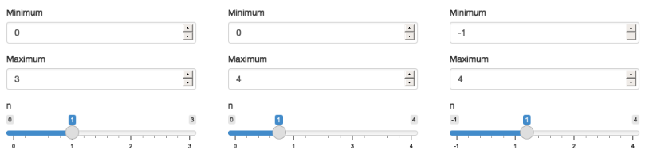
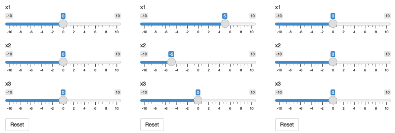
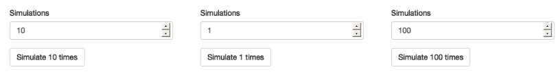
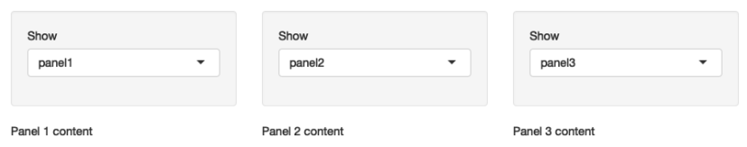
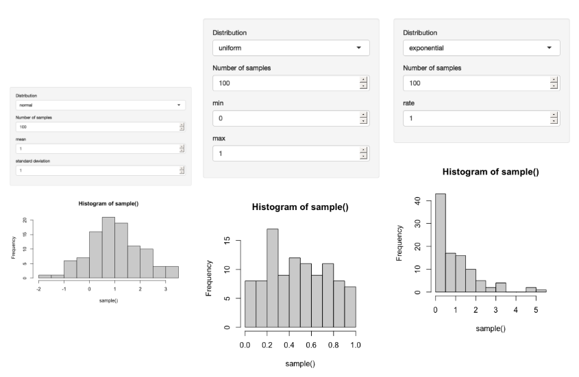
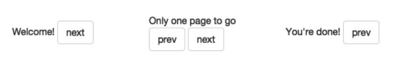
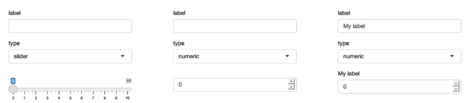
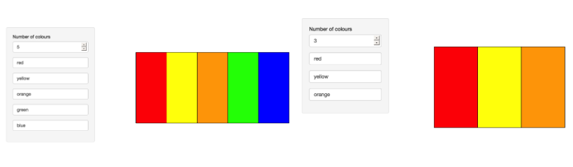
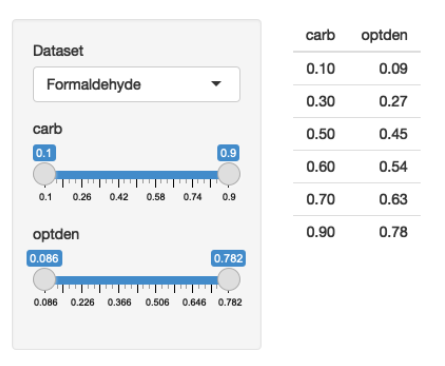

## Introdução

Até agora, vimos uma separação clara entre a interface do usuário (`ui`) e a função `server`: a `ui` é definida estaticamente quando o app é iniciado.

Neste capítulo, você aprenderá a criar **interfaces de usuário dinâmicas**, alterando a `ui` usando código executado na função `server`.

Existem três técnicas principais para criar UIs dinâmicas:

1.  Usar a família de funções `update*()` para modificar parâmetros de controles de input existentes.
2.  Usar `tabsetPanel()` para mostrar e esconder partes da UI condicionalmente.
3.  Usar `uiOutput()` e `renderUI()` para gerar partes da UI com código.

Essas ferramentas dão um poder considerável para responder ao usuário.
No entanto, elas também podem tornar seu app mais complexo, então use-as com moderação e sempre prefira a técnica mais simples que resolva seu problema.

```{r setup}
library(shiny)
library(dplyr, warn.conflicts = FALSE)
```

------------------------------------------------------------------------

## Atualizando Inputs

Começaremos com uma técnica simples que permite modificar um input depois que ele foi criado: a família de funções `update`.
Cada controle de input (ex: `sliderInput()`) tem uma função de atualização correspondente (ex: `updateSliderInput()`).

No exemplo abaixo, dois `numericInput` controlam os valores de `min` e `max` de um `sliderInput`.
Usamos `observeEvent()` para disparar a função `updateSliderInput()` sempre que os inputs `min` ou `max` mudam.

```{r}
ui <- fluidPage(
  numericInput("min", "Minimum", 0),
  numericInput("max", "Maximum", 3),
  sliderInput("n", "n", min = 0, max = 3, value = 1)
)
server <- function(input, output, session) {
  observeEvent(input$min, {
    updateSliderInput(inputId = "n", min = input$min)
  })
  observeEvent(input$max, {
    updateSliderInput(inputId = "n", max = input$max)
  })
}
```

*Figura: O app ao carregar (esquerda), após aumentar o max (meio), e então diminuir o min (direita).* 

As funções de atualização sempre recebem o `inputId` do controle a ser modificado como um string.
Os argumentos restantes correspondem aos parâmetros do controle que podem ser alterados após sua criação.

------------------------------------------------------------------------

### Usos Simples

As funções de atualização são ótimas para pequenas conveniências do usuário.

**Exemplo 1: Botão de Reset** Podemos criar um `actionButton` para resetar vários sliders para seus valores iniciais.

```{r}
ui <- fluidPage(
  sliderInput("x1", "x1", 0, min = -10, max = 10),
  sliderInput("x2", "x2", 0, min = -10, max = 10),
  sliderInput("x3", "x3", 0, min = -10, max = 10),
  actionButton("reset", "Reset")
)

server <- function(input, output, session) {
  observeEvent(input$reset, {
    updateSliderInput(inputId = "x1", value = 0)
    updateSliderInput(inputId = "x2", value = 0)
    updateSliderInput(inputId = "x3", value = 0)
  })
}
```

*Figura: O app ao carregar (esquerda), após arrastar alguns sliders (meio), e então clicar em reset (direita).* 

------------------------------------------------------------------------

**Exemplo 2: Rótulo de Botão Dinâmico** Podemos alterar o texto de um `actionButton` para refletir o estado atual de outro input.

```{r}
ui <- fluidPage(
  numericInput("n", "Simulations", 10),
  actionButton("simulate", "Simulate")
)

server <- function(input, output, session) {
  observeEvent(input$n, {
    label <- paste0("Simulate ", input$n, " times")
    updateActionButton(inputId = "simulate", label = label)
  })
}
```

*Figura: O app ao carregar (esquerda), após definir as simulações para 1 (meio), e então para 100 (direita).* 

------------------------------------------------------------------------

### Caixas de Seleção Hierárquicas

Uma aplicação mais complexa e muito útil é permitir a exploração interativa de dados hierárquicos.

Vamos usar um dataset de vendas imaginário.
A hierarquia é: \* Território -\> Cliente -\> Pedido -\> Itens do Pedido

Queremos criar uma UI onde o usuário seleciona um território para ver os clientes, depois um cliente para ver seus pedidos, e assim por diante.

A `ui` terá três `selectInput` e uma `tableOutput`.
As opções para cliente e pedido serão geradas dinamicamente, então iniciamos com `choices = NULL`.

```{r}
# Carregando os dados (assumindo que o arquivo está em uma pasta 'sales-dashboard')
# sales <- vroom::vroom("sales-dashboard/sales_data_sample.csv", col_types = list(), na = "")

# Para este exemplo, vamos criar um dataframe de amostra
sales <- data.frame(
  TERRITORY = rep(c("EMEA", "NA"), each = 4),
  CUSTOMERNAME = rep(c("Lyon Souveniers", "Toys4Us"), each = 2),
  ORDERNUMBER = 101:108,
  QUANTITYORDERED = sample(1:5, 8, replace = TRUE),
  PRICEEACH = runif(8, 50, 100),
  PRODUCTCODE = paste0("S", 18, "_", sample(1000:4000, 8))
)


ui <- fluidPage(
  selectInput("territory", "Territory", choices = unique(sales$TERRITORY)),
  selectInput("customername", "Customer", choices = NULL),
  selectInput("ordernumber", "Order number", choices = NULL),
  tableOutput("data")
)
```

No `server`, trabalhamos de cima para baixo na hierarquia:

```{r}
server <- function(input, output, session) {
  # 1. Filtra os dados com base no território selecionado
  territory <- reactive({
    filter(sales, TERRITORY == input$territory)
  })
  # 2. Quando o território muda, atualiza as opções de cliente
  observeEvent(territory(), {
    choices <- unique(territory()$CUSTOMERNAME)
    updateSelectInput(inputId = "customername", choices = choices)
  })

  # 3. Filtra os dados do território com base no cliente selecionado
  customer <- reactive({
    req(input$customername)
    filter(territory(), CUSTOMERNAME == input$customername)
  })
  # 4. Quando o cliente muda, atualiza as opções de pedido
  observeEvent(customer(), {
    choices <- unique(customer()$ORDERNUMBER)
    updateSelectInput(inputId = "ordernumber", choices = choices)
  })

  # 5. Exibe os dados do pedido selecionado
  output$data <- renderTable({
    req(input$ordernumber)
    customer() %>%
      filter(ORDERNUMBER == input$ordernumber) %>%
      select(QUANTITYORDERED, PRICEEACH, PRODUCTCODE)
  })
}
```

*Abre o link: Selecione "EMEA", depois "Lyon Souveniers", e então veja os pedidos.* <https://hadley.shinyapps.io/ms-update-nested/>

------------------------------------------------------------------------

### Congelando Inputs Reativos

Às vezes, uma mudança hierárquica pode criar um estado inválido por um breve momento, causando um "flicker" no output.
Por exemplo, ao mudar de um dataset para outro, a variável selecionada do dataset antigo pode não existir no novo, causando um erro momentâneo.

Para resolver isso, usamos `freezeReactiveValue()`.
Isso "congela" um input, garantindo que nenhum reativo ou output que o utilize seja atualizado até a próxima rodada completa de invalidação, quando o `updateSelectInput()` já tiver tido efeito.

```{r}
# Exemplo de UI
ui <- fluidPage(
  selectInput("dataset", "Choose a dataset", c("pressure", "cars")),
  selectInput("column", "Choose column", character(0)),
  verbatimTextOutput("summary")
)

# Server com freezeReactiveValue()
server <- function(input, output, session) {
  dataset <- reactive(get(input$dataset, "package:datasets"))

  observeEvent(input$dataset, {
    freezeReactiveValue(input, "column")
    updateSelectInput(inputId = "column", choices = names(dataset()))
  })

  output$summary <- renderPrint({
    summary(dataset()[[input$column]])
  })
}
```

**Boa prática:** Sempre use `freezeReactiveValue()` quando você altera dinamicamente o valor de um input.

------------------------------------------------------------------------

### Referências Circulares

Quando você usa uma função `update*` para alterar o `value` de um input, essa alteração pode disparar outras reações, assim como uma ação do usuário.
Isso pode criar referências circulares e loops infinitos.

**Exemplo de Loop Infinito:**

```{r}
# Este app ficará preso em um loop infinito, incrementando 'n' para sempre.
ui <- fluidPage(numericInput("n", "n", 0))
server <- function(input, output, session) {
  observeEvent(input$n,
    updateNumericInput(inputId = "n", value = input$n + 1)
  )
}
```

**Exemplo de Inputs Inter-relacionados:** Um app de conversão de temperatura onde alterar Celsius atualiza Fahrenheit, e vice-versa.
Isso pode funcionar, mas pode levar a múltiplos updates em cascata e comportamento instável.
É melhor evitar ter múltiplas "fontes da verdade" para a mesma ideia.

```{r}
ui <- fluidPage(
  numericInput("temp_c", "Celsius", NA, step = 1),
  numericInput("temp_f", "Fahrenheit", NA, step = 1)
)

server <- function(input, output, session) {
  observeEvent(input$temp_f, {
    c <- round((input$temp_f - 32) * 5 / 9)
    updateNumericInput(inputId = "temp_c", value = c)
  })

  observeEvent(input$temp_c, {
    f <- round((input$temp_c * 9 / 5) + 32)
    updateNumericInput(inputId = "temp_f", value = f)
  })
}
```

* Abre <https://hadley.shinyapps.io/ms-temperature> 
* Coloque 120 F, aperte a seta para baixo.
* F muda para 119, e C é atualizada para 48.
* 48 C converta a 118 F, então F muda de novo para 118.

Felizmente 118 F ainde é 48 C, então as atualização param.

------------------------------------------------------------------------

## Visibilidade Dinâmica

Outra técnica para UIs dinâmicas é mostrar e esconder partes da interface.
Uma maneira inteligente de fazer isso sem precisar de JavaScript é usar um `tabsetPanel` com abas escondidas.

-   Use `tabsetPanel(type = "hidden", ...)` para criar um contêiner de abas sem as abas visíveis.
-   Use `updateTabsetPanel(inputId = "switcher", selected = ...)` no `server` para trocar qual `tabPanelBody` está visível.

```{r}
ui <- fluidPage(
  sidebarLayout(
    sidebarPanel(
      selectInput("controller", "Show", choices = paste0("panel", 1:3))
    ),
    mainPanel(
      tabsetPanel(
        id = "switcher",
        type = "hidden",
        tabPanelBody("panel1", "Panel 1 content"),
        tabPanelBody("panel2", "Panel 2 content"),
        tabPanelBody("panel3", "Panel 3 content")
      )
    )
  )
)

server <- function(input, output, session) {
  observeEvent(input$controller, {
    updateTabsetPanel(inputId = "switcher", selected = input$controller)
  })
}
```

*Figura: Selecionando panel1 (esquerda), depois panel2 (meio), e então panel3 (direita).* 

------------------------------------------------------------------------

### UI Condicional

Podemos usar essa técnica para mostrar diferentes controles de input dependendo de uma seleção do usuário.
Por exemplo, um app de simulação que mostra parâmetros diferentes para distribuições diferentes (normal, uniforme, exponencial).

```{r app_ui_condicional}
# UI com um tabset escondido para os parâmetros
parameter_tabs <- tabsetPanel(
  id = "params",
  type = "hidden",
  tabPanel("normal",
    numericInput("mean", "mean", value = 1),
    numericInput("sd", "standard deviation", min = 0, value = 1)
  ),
  tabPanel("uniform",
    numericInput("min", "min", value = 0),
    numericInput("max", "max", value = 1)
  ),
  tabPanel("exponential",
    numericInput("rate", "rate", value = 1, min = 0),
  )
)

ui <- fluidPage(
  sidebarLayout(
    sidebarPanel(
      selectInput("dist", "Distribution", choices = c("normal", "uniform", "exponential")),
      numericInput("n", "Number of samples", value = 100),
      parameter_tabs
    ),
    mainPanel(plotOutput("hist"))
  )
)

# Server para trocar as abas e gerar os dados
server <- function(input, output, session) {
  observeEvent(input$dist, {
    updateTabsetPanel(inputId = "params", selected = input$dist)
  })

  sample <- reactive({
    switch(input$dist,
      normal = rnorm(input$n, input$mean, input$sd),
      uniform = runif(input$n, input$min, input$max),
      exponential = rexp(input$n, input$rate)
    )
  })
  output$hist <- renderPlot(hist(sample()), res = 96)
}
```

*Figura: Resultados para as distribuições normal (esquerda), uniforme (meio) e exponencial (direita).* 

------------------------------------------------------------------------

### Interface de Assistente (Wizard)

Podemos usar a mesma ideia para criar um "assistente" que guia o usuário através de múltiplas páginas de um formulário.

```{r app_wizard}
ui <- fluidPage(
  tabsetPanel(
    id = "wizard",
    type = "hidden",
    tabPanel("page_1", "Welcome!", actionButton("page_12", "next")),
    tabPanel("page_2", "Only one page to go",
      actionButton("page_21", "prev"),
      actionButton("page_23", "next")
    ),
    tabPanel("page_3", "You're done!", actionButton("page_32", "prev"))
  )
)

server <- function(input, output, session) {
  switch_page <- function(i) {
    updateTabsetPanel(inputId = "wizard", selected = paste0("page_", i))
  }

  observeEvent(input$page_12, switch_page(2))
  observeEvent(input$page_21, switch_page(1))
  observeEvent(input$page_23, switch_page(3))
  observeEvent(input$page_32, switch_page(2))
}
```

*Figura: Uma interface de assistente que divide uma UI complexa em múltiplas páginas.* 

------------------------------------------------------------------------

## Criando UI com Código

Quando as técnicas anteriores não são dinâmicas o suficiente, podemos gerar a UI diretamente no `server`.
Isso é útil quando o número ou tipo de controles depende de outros inputs.

O processo tem duas partes:

-   **`uiOutput()`**: Insere um espaço reservado na sua `ui`.
-   **`renderUI()`**: É chamado no `server()` para preencher esse espaço com UI gerada dinamicamente.

### Primeiros Passos

Um app simples que cria dinamicamente um `sliderInput` ou `numericInput`.

```{r}
ui <- fluidPage(
  textInput("label", "label"),
  selectInput("type", "type", c("slider", "numeric")),
  uiOutput("numeric")
)
server <- function(input, output, session) {
  output$numeric <- renderUI({
    # Preservando o valor com isolate()
    value <- isolate(input$dynamic)
    if (input$type == "slider") {
      sliderInput("dynamic", input$label, value = 0, min = 0, max = 10)
    } else {
      numericInput("dynamic", input$label, value = 0, min = 0, max = 10)
    }
  })
}
```

*Figura: App ao carregar (esquerda), mudando o tipo para numérico (meio), e então o rótulo (direita).* 

**Desvantagens:**

-   **Lag:** A UI gerada dinamicamente pode demorar uma fração de segundo para aparecer.
-   **Perda de Estado:** Ao recriar um controle, seu valor atual é perdido. Usamos `isolate(input$dynamic)` para ler o valor antigo sem criar uma dependência reativa e passá-lo para o novo controle.

------------------------------------------------------------------------

### Múltiplos Controles

A UI dinâmica é mais útil quando geramos um número arbitrário de controles.
Podemos usar programação funcional (`purrr::map`) para isso.

**Exemplo:** Permitir que o usuário defina uma paleta de cores.
Primeiro, ele escolhe o número de cores; depois, o app gera um `textInput` para cada cor.

```{r app_multiplos_controles}
library(purrr)

ui <- fluidPage(
  sidebarLayout(
    sidebarPanel(
      numericInput("n", "Number of colours", value = 5, min = 1),
      uiOutput("col"),
    ),
    mainPanel(
      plotOutput("plot")
    )
  )
)

server <- function(input, output, session) {
  col_names <- reactive(paste0("col", seq_len(input$n)))

  output$col <- renderUI({
    map(col_names(), ~ textInput(.x, NULL, value = isolate(input[[.x]])))
  })

  output$plot <- renderPlot({
    cols <- map_chr(col_names(), ~ input[[.x]] %||% "")
    # Converte inputs vazios para transparente
    cols[cols == ""] <- NA

    barplot(rep(1, length(cols)), col = cols, space = 0, axes = FALSE)
  }, res = 96)
}
```

*Figura: Preenchendo as cores (esquerda), e então reduzindo o número de cores para 3 (direita); note que as cores existentes são preservadas.* 

**Nota:** Para acessar inputs criados dinamicamente, usamos `input[[nome_do_input_como_string]]` em vez de `input$nome_do_input`.

------------------------------------------------------------------------

### Filtragem Dinâmica

Para finalizar, um app que gera dinamicamente controles de filtro para qualquer data frame.

```{r app_filtragem_dinamica}
# Funções auxiliares
make_ui <- function(x, var) {
  if (is.numeric(x)) {
    rng <- range(x, na.rm = TRUE)
    sliderInput(var, var, min = rng[1], max = rng[2], value = rng)
  } else if (is.factor(x)) {
    levs <- levels(x)
    selectInput(var, var, choices = levs, selected = levs, multiple = TRUE)
  } else {
    NULL
  }
}

filter_var <- function(x, val) {
  if (is.numeric(x)) {
    !is.na(x) & x >= val[1] & x <= val[2]
  } else if (is.factor(x)) {
    x %in% val
  } else {
    TRUE
  }
}

# App
dfs <- keep(ls("package:datasets"), ~ is.data.frame(get(.x, "package:datasets")))

ui <- fluidPage(
  sidebarLayout(
    sidebarPanel(
      selectInput("dataset", label = "Dataset", choices = dfs),
      uiOutput("filter")
    ),
    mainPanel(
      tableOutput("data")
    )
  )
)
server <- function(input, output, session) {
  data <- reactive(get(input$dataset, "package:datasets"))
  vars <- reactive(names(data()))

  output$filter <- renderUI(
    map(vars(), ~ make_ui(data()[[.x]], .x))
  )

  selected <- reactive({
    each_var <- map(vars(), ~ filter_var(data()[[.x]], input[[.x]]))
    reduce(each_var, `&`)
  })

  output$data <- renderTable(head(data()[selected(), ], 12))
}
```

*Figura: Uma UI de filtro gerada dinamicamente a partir das colunas do dataset selecionado.* 

------------------------------------------------------------------------

## Resumo

Neste capítulo, você aprendeu a criar UIs dinâmicas que respondem às ações do usuário.

-   **`update*()`**: Modifica inputs existentes.
-   **Visibilidade Dinâmica**: Usa `tabsetPanel` escondido para mostrar/ocultar partes da UI.
-   **UI com Código (`renderUI`/`uiOutput`)**: A técnica mais poderosa para gerar UI dinamicamente a partir do `server`.

Use sempre a técnica mais simples que resolva seu problema para manter seu app fácil de entender e depurar.
